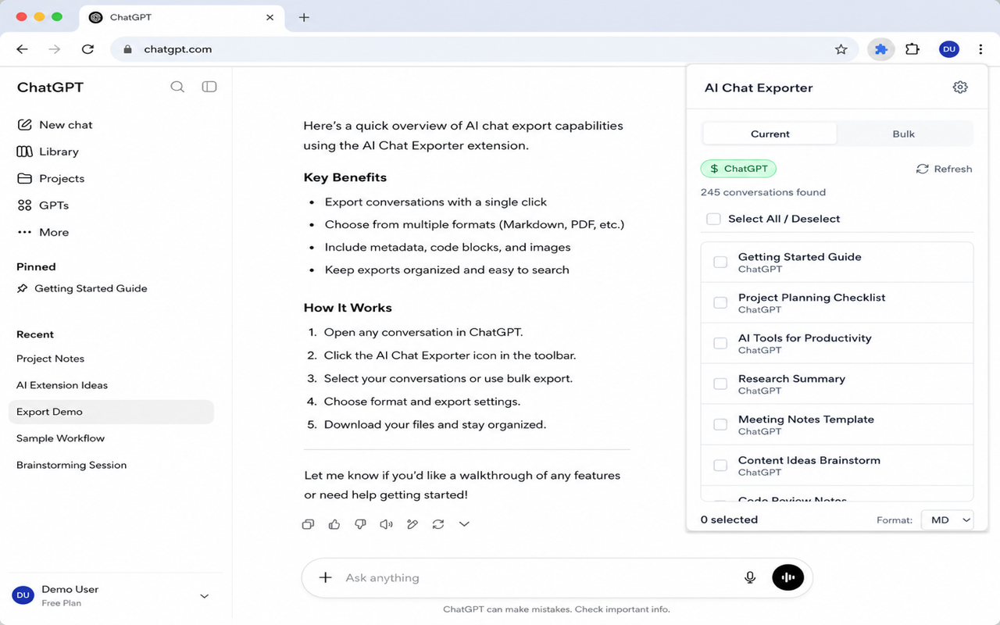

<div align="center">

# AI Chat Exporter

English | [简体中文](README.zh-CN.md)

**Export ChatGPT, Gemini, Claude, DeepSeek & Grok conversations to clean PDF, Markdown or ZIP archives. 100% free. No paywalls. No accounts. No tracking.**

[](https://chromewebstore.google.com/detail/ai-chat-exporter/kdafdajkiljhghecdkeogldafhjgmgpk)
[](https://addons.mozilla.org/en-US/firefox/addon/pinguarmy-ai-chat-exporter/)
[](https://microsoftedge.microsoft.com/addons/detail/ai-chat-exporter/ndjcmigocoflghenpchbldpkaccechpg)
[](LICENSE)
[](https://github.com/pinguarmy/ai-chat-exporter/actions/workflows/ci.yml)
[](https://www.typescriptlang.org/)
[](https://wxt.dev)

<br/>



[Install](#install) · [Features](#features) · [Usage](#usage) · [Privacy](#privacy) · [Support](#support) · [Development](#development)

</div>

---

## Install

Latest release: **v1.5.0**. See [GitHub Releases](https://github.com/pinguarmy/ai-chat-exporter/releases) for downloads and [1.5.0 store rollout status](docs/releases/1.5.0-status.md) for which store listings have the update yet; store review can lag behind GitHub.

| Browser | Get it |
| --- | --- |
| Chrome | [Chrome Web Store](https://chromewebstore.google.com/detail/ai-chat-exporter/kdafdajkiljhghecdkeogldafhjgmgpk) |
| Firefox | [Firefox Add-ons](https://addons.mozilla.org/en-US/firefox/addon/pinguarmy-ai-chat-exporter/) |
| Edge | [Edge Add-ons](https://microsoftedge.microsoft.com/addons/detail/ai-chat-exporter/ndjcmigocoflghenpchbldpkaccechpg) |
| Any of the above | [GitHub Releases](https://github.com/pinguarmy/ai-chat-exporter/releases) (ZIP packages; build from source is described in [CONTRIBUTING.md](CONTRIBUTING.md)) |

The interface is available in English, 简体中文, 繁體中文, Deutsch, 日本語 and 한국어.

## Supported platforms and formats

- **Platforms:** ChatGPT, Gemini, Claude, DeepSeek and Grok.
- **Reading PDF:** print-ready, with headings, lists, code blocks, LaTeX, images and page breaks.
- **Editable Markdown:** structured `.md` with code blocks, LaTeX and optional metadata.
- **Archive ZIP:** Markdown plus `references.json`, `trace.json`, a `manifest.json` that hashes each payload, and inline artifact files. External attachments are not downloaded and the manifest says so.

## Features

- **Single conversation or bulk.** Export the open chat, or load your signed-in history and export many conversations at once with search, date and quantity rules.
- **Preview and message selection.** Copy or download all messages, hand-picked messages, or just the last answer. Partial exports are always labelled as partial.
- **Completeness-aware.** The exporter uses provider data when it can verify it and says so when it cannot. A visible-page snapshot is never presented as a complete archive; see the [user guide](docs/user-guide.md#capture-the-visible-page).
- **Scheduled auto-export.** Optional Markdown-only runs on a bounded schedule, while the browser and extension are running.
- **Filenames and folders.** Template tokens such as `{date}`, `{title}`, `{platform}` and `{last_message_datetime}`; save to the Downloads root, per-platform folders or a custom folder. Unicode titles are preserved.
- **Share copy.** Optionally redact common credential patterns before sharing. It is a heuristic, not anonymization; always review the result.
- **Optional local recovery** for page snapshots, off by default.
- **Free and open source.** MIT licensed, no extension accounts, no analytics, no paid export caps.

## Usage

1. Open a conversation on ChatGPT, Gemini, Claude, DeepSeek or Grok.
2. Click the **AI Chat Exporter** toolbar icon.
3. Choose **Editable Markdown**, **Reading PDF** or **Archive ZIP**, check the filename and output summary, then click **Export**.
4. For many chats, open the **Bulk** tab, select conversations, and click **Export Selected**.

Everything else, including selection and preview, bulk and background exports, filename tokens, download folders and scheduled export, is in the [user guide](docs/user-guide.md).

## Privacy

Exports are built in your browser and are not sent to extension-operated servers. The extension talks only to the AI platform you are already signed in to, uses no analytics or tracking, and keeps settings in local browser storage. The source is fully auditable. Read the full [privacy policy](PRIVACY.md) ([web version](https://pinguarmy.github.io/ai-chat-exporter/PRIVACY.md)).

## Support

Email [extensions@pengyuhao.com](mailto:extensions@pengyuhao.com) without a GitHub account, or use [GitHub Issues](https://github.com/pinguarmy/ai-chat-exporter/issues). Do not send private chats, credentials, or unredacted exports. The [optional feedback page](https://pinguarmy.github.io/ai-chat-exporter/uninstall.html) submits privately to the maintainer when you click Submit; no account, email application, or automatic submission is involved. Feedback processing and retention are described in the [privacy policy](PRIVACY.md).

## Development

Node 22 (`.nvmrc`):

```bash
npm ci
npm run dev        # WXT dev mode (hot reload)
npm test           # unit and jsdom suite
npm run lint       # typecheck (src and tests), ESLint, Prettier check
npm run build      # Chrome/Edge, Firefox and source-review packages
```

`npm run test:browser` runs an unpacked-extension smoke test and needs a prior build; it does not log into providers. Unit tests passing does not prove a live provider integration works.

| Read this | For |
| --- | --- |
| [CONTRIBUTING.md](CONTRIBUTING.md) | Setup, scripts, code style, pull requests, build outputs |
| [GUIDE.md](GUIDE.md) | Architecture and the provider data-integrity model |
| [docs/MAINTENANCE.md](docs/MAINTENANCE.md) | Verification and release gates |
| [docs/release-workflow.md](docs/release-workflow.md) | Publishing to Chrome, Firefox, Edge and GitHub (read before any release) |
| [docs/README.md](docs/README.md) | Index of all documentation |

### Project structure

```
src/
├── core/          pure logic: conversation model, integrity, exporters, filenames, i18n (no chrome.*)
├── providers/     provider parsers and APIs, shared parser runtime
├── platform/      browser-extension adapters (storage, downloads) and typed background messages
├── hooks/         shared React hooks
├── background/    service worker modules (entry: index.ts)
├── components/    popup/ and options/ UI
├── contents/      one content script per provider
├── tabs/          preview, export workspace and recovery pages
└── styles/
tests/             Vitest suite mirroring src/ (see tests/README.md)
scripts/           build, verification, publishing
store-assets/      store screenshots and promotional art
docs/              user guide, maintenance, release and design docs
```

Layer rules and where new code goes: [src/README.md](src/README.md).

## Contributing

Contributions are welcome. Fork, branch, run `npm test` and `npm run lint`, and open a pull request; see [CONTRIBUTING.md](CONTRIBUTING.md) for the process and the list of good first issues.

## License

[MIT](LICENSE)

## Acknowledgments

- Built with [WXT](https://wxt.dev/), the browser extension framework
- UI design inspired by [Linear](https://linear.app/) and [Notion](https://notion.so/)
- PDF generation via [jsPDF](https://github.com/parallax/jsPDF) + [html2canvas](https://github.com/niklasvh/html2canvas)

---

<div align="center">

Built and maintained by [pinguarmy](https://github.com/pinguarmy). If this saved you time, a GitHub star helps others find it.

</div>
