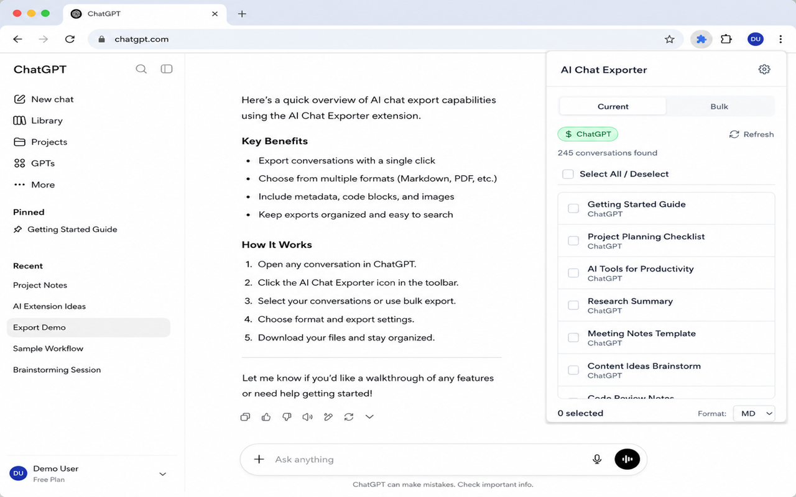

<div align="center">

# AI Chat Exporter

[English](README.md) | 简体中文

**把 ChatGPT、Gemini、Claude、DeepSeek、Grok 的对话导出为清晰的 PDF、Markdown 或 ZIP 归档。完全免费，无付费墙，无需注册账号，不做追踪。**

[](https://chromewebstore.google.com/detail/ai-chat-exporter/kdafdajkiljhghecdkeogldafhjgmgpk)
[](https://addons.mozilla.org/en-US/firefox/addon/pinguarmy-ai-chat-exporter/)
[](https://microsoftedge.microsoft.com/addons/detail/ai-chat-exporter/ndjcmigocoflghenpchbldpkaccechpg)
[](LICENSE)
[](https://github.com/pinguarmy/ai-chat-exporter/actions/workflows/ci.yml)
[](https://www.typescriptlang.org/)
[](https://plasmo.com)

<br/>



[安装](#安装) · [功能](#功能) · [使用方法](#使用方法) · [隐私](#隐私) · [反馈与支持](#反馈与支持) · [参与开发](#参与开发)

</div>

---

## 安装

最新版本：**v1.5.0**。安装包见 [GitHub Releases](https://github.com/pinguarmy/ai-chat-exporter/releases)；各商店是否已上架 1.5.0，请看 [1.5.0 商店发布状态](docs/releases/1.5.0-status.md)（商店审核通常比 GitHub 慢一些）。

| 浏览器 | 获取方式 |
| --- | --- |
| Chrome | [Chrome 应用商店](https://chromewebstore.google.com/detail/ai-chat-exporter/kdafdajkiljhghecdkeogldafhjgmgpk) |
| Firefox | [Firefox 附加组件](https://addons.mozilla.org/en-US/firefox/addon/pinguarmy-ai-chat-exporter/) |
| Edge | [Edge 加载项](https://microsoftedge.microsoft.com/addons/detail/ai-chat-exporter/ndjcmigocoflghenpchbldpkaccechpg) |
| 以上任一浏览器 | [GitHub Releases](https://github.com/pinguarmy/ai-chat-exporter/releases)（ZIP 安装包；从源码构建见 [CONTRIBUTING.md](CONTRIBUTING.md)） |

扩展界面支持英文、简体中文、繁体中文、德语、日语、韩语。

## 支持的平台与格式

- **平台：** ChatGPT、Gemini、Claude、DeepSeek、Grok。
- **阅读版 PDF：** 适合打印，保留标题、列表、代码块、LaTeX 公式、图片和分页。
- **可编辑 Markdown：** 结构清晰的 `.md`，保留代码块和 LaTeX，可选附带元数据。
- **归档 ZIP：** 在 Markdown 之外附带 `references.json`、`trace.json`、记录各文件哈希的 `manifest.json` 以及内嵌的产物文件。外部附件不会被下载，清单中会明确注明。

## 功能

- **单个对话或批量导出。** 导出当前打开的对话，也可以加载已登录账号的历史记录，按搜索、日期和数量规则一次导出多个对话。
- **预览与按消息选择。** 可复制或下载全部消息、手动勾选的消息，或只取最后一条回答。部分导出一定会标明“部分”。
- **关注完整性。** 能验证服务商返回的数据时才按完整记录导出，无法验证时会明确提示。仅来自当前页面的快照不会被当作完整归档，详见[使用指南](docs/user-guide.md#capture-the-visible-page)（英文）。
- **定时自动导出。** 可选功能，仅导出 Markdown，在浏览器和扩展保持运行时按设定的周期执行。
- **文件名与保存位置。** 文件名模板支持 `{date}`、`{title}`、`{platform}`、`{last_message_datetime}` 等变量；可保存到下载目录根部、按平台分文件夹或自定义文件夹，中日韩等 Unicode 标题会原样保留。
- **分享副本。** 可在分享前隐藏常见的密钥和凭据格式。这只是启发式处理，并非匿名化，分享前请自行检查。
- **可选的本地恢复**，针对页面快照，默认关闭。
- **免费开源。** MIT 许可，无需扩展账号，没有统计分析，也没有付费导出次数限制。

## 使用方法

1. 在 ChatGPT、Gemini、Claude、DeepSeek 或 Grok 中打开一个对话。
2. 点击浏览器工具栏中的 **AI Chat Exporter** 图标。
3. 选择“可编辑 Markdown”、“阅读版 PDF”或“归档 ZIP”，确认文件名和输出范围说明后点击导出。
4. 想一次导出多个对话，切换到“批量”标签页，勾选对话后点击导出所选。

选择与预览、批量与后台导出、文件名变量、下载文件夹和定时导出等更多细节，见[使用指南](docs/user-guide.md)（英文）。

## 隐私

导出内容在你的浏览器本地生成，不会发送到扩展运营方的服务器。扩展只会与你已登录的 AI 平台通信，不使用统计分析或追踪，设置保存在浏览器本地存储中，源码可供审查。完整说明见[隐私政策](PRIVACY.md)（[网页版](https://pinguarmy.github.io/ai-chat-exporter/PRIVACY.md)，英文）。

## 反馈与支持

无需 GitHub 账号，可发邮件至 [extensions@pengyuhao.com](mailto:extensions@pengyuhao.com)，也可以在 [GitHub Issues](https://github.com/pinguarmy/ai-chat-exporter/issues) 提交问题。**请不要发送私人聊天记录、凭据或未打码的导出文件。** [可选的反馈页面](https://pinguarmy.github.io/ai-chat-exporter/uninstall.html)只在你点击提交后才会把内容私下发给维护者，不需要账号，也不会唤起邮件程序或自动提交。反馈的处理与保留方式见[隐私政策](PRIVACY.md)。

## 参与开发

需要 Node 22（见 `.nvmrc`）：

```bash
npm ci
npm run dev        # Plasmo 开发模式
npm test           # 单元与 jsdom 测试
npm run lint       # 类型检查、ESLint、Prettier 检查
npm run build      # 生成 Chrome/Edge、Firefox 和源码审查包
```

`npm run test:browser` 会加载未打包的扩展做冒烟测试，需要先执行构建，不会登录任何服务商。单元测试通过并不能证明各平台的线上适配可用。

开发文档均为英文，入口如下：

| 文档 | 内容 |
| --- | --- |
| [CONTRIBUTING.md](CONTRIBUTING.md) | 环境搭建、脚本、代码风格、提交 PR、构建产物 |
| [GUIDE.md](GUIDE.md) | 架构与服务商数据完整性模型 |
| [docs/MAINTENANCE.md](docs/MAINTENANCE.md) | 验证与发布检查 |
| [docs/release-workflow.md](docs/release-workflow.md) | 三商店与 GitHub 发布流程（中文，发布前必读） |
| [docs/README.md](docs/README.md) | 全部文档索引 |

源码目录分层：`src/core/`（纯逻辑、导出器、i18n，不使用 `chrome.*`）、`src/providers/`（各平台解析器与接口）、`src/platform/`（浏览器扩展适配层）、`src/background/`（后台 service worker）、`src/components/`（弹窗与设置页界面）、`src/contents/`（每个平台一个内容脚本）、`src/tabs/`（预览、导出工作区、恢复页）。详见 [src/README.md](src/README.md)。

欢迎贡献：Fork 后新建分支，运行 `npm test` 与 `npm run lint`，再提交 Pull Request，流程见 [CONTRIBUTING.md](CONTRIBUTING.md)。

## 许可证

[MIT](LICENSE)

## 致谢

- 基于浏览器扩展框架 [Plasmo](https://plasmo.com/) 构建
- 界面设计参考了 [Linear](https://linear.app/) 与 [Notion](https://notion.so/)
- PDF 生成使用 [jsPDF](https://github.com/parallax/jsPDF) 与 [html2canvas](https://github.com/niklasvh/html2canvas)

---

<div align="center">

由 [pinguarmy](https://github.com/pinguarmy) 开发并维护。如果它帮你省了时间，欢迎在 GitHub 上点个 Star。

</div>
